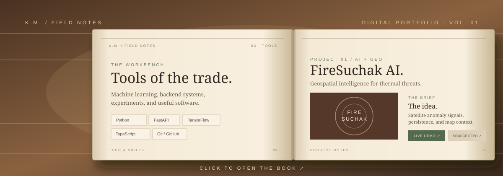

# Hi there, I'm Keshav Mishra 👋

Welcome to my personal archive and development workbench.

## 📖 My Portfolio Book

*Click above or visit [keshavmishra27.github.io/portfolio-book](https://keshavmishra27.github.io/portfolio-book/) to turn the pages and explore my featured projects, technical workbench, and interactive demos.*

---

### 🛠️ Core Focus & Technologies
- **AI & Geospatial Intelligence:** Python, Satellite Data Analysis (NASA FIRMS, Earth Observation), Deep Learning (RNN/GRU)
- **Software Engineering & Web:** TypeScript, FastAPI, Vite, Modern Responsive Web, REST APIs
- **Interactive Experiments:** Canvas-based physics & game prototypes, interactive developer tools

## 📈 GitHub Contributions

Find more of my repositories and projects below!
